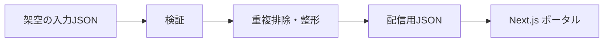

# public-ohisama-backend

架空データを検証・整形し、ポータル向けJSONを生成するPythonバッチです。
個人開発サービスでの「収集後のデータをファイルにまとめて配信する」設計を、公開用に再構成しています。
標準ライブラリだけで動作し、APIサーバー、DB、外部通信、認証情報は必要ありません。

## 動作確認

Python 3.12以降を使用します。固定バージョンは `.python-version` に記載しています。

```sh
python pipeline.py
python -m unittest discover -s tests -v
python scripts/verify_public.py
```

`samples/input.json` から `output/` に6つのJSONを出力します。
`output/` はローカル生成物で、公開対象には含めません。
サンプルには同一ID・同一内容の重複を1件含めており、20件の入力から19件を出力します。

## ポータルとの連携

両リポジトリを同じ親フォルダに配置します。

```sh
python pipeline.py --output ../public-ohisama-portal/data
```

フロントはJSONを直接importします。起動時にバックエンドへアクセスする処理はありません。
ポータルには同じ生成済みサンプルも同梱するため、単独で起動できます。
既存出力を更新する場合、架空データを示す `demo.json` が必要です。



## データ契約と判断理由

- `members.json`: 架空メンバーの一覧。
- `content.tver.target.json` / `content.youtube.target.json` / `content.other.target.json`: `{ updated, content }` 形式。サービス名は分類例で、実データは取得しません。
- `content.last_checked_date.json`: デモ基準日時。
- `demo.json`: 架空データの識別、固定時計、公開デモ専用の期限表示期間。

本文から期限を推測せず、タイムゾーン付き `expiresAt` をそのまま使います。
メンバーも明示指定し、名前や説明文からの自動判定はしません。
期限表示の条件は本番の再現ではなく、公開デモの説明用です。

許可フィールド、ID、参照整合性、日付、URLを検証します。
URLは `https://example.com`、画像はローカルプレースホルダーに限定しています。
同一内容の重複は統合し、内容が異なる同一IDはエラーにします。
全件検証後に出力するため入力不備では既存出力を変更せず、同じ入力の再実行では同じJSONになります。
ファイル配信は保守負担を抑えられる一方、大規模検索や同時更新には向かず、その段階では保存先・配信方式の見直しが必要です。

## 公開範囲

本番のデータ、収集先、スクレイピング、取得先固有の条件、タグ自動判定、SNS投稿、秘密情報、本番のGit履歴は含めません。
一般的な処理と、新規作成した架空データで構成しています。
AWSへの移行、分析基盤、実サイトの取得はこのデモには実装していません。

`public-files.json` が公開ファイルの許可リストです。ファイル追加時は内容をレビューしてから更新してください。
検査はソース・設定・ドキュメント・SVG・データを対象にします。文字列検査だけで機密性を保証するものではなく、人による差分確認も必要です。

```sh
python scripts/export_public.py --output ../public-backend-export
```

新規フォルダへ許可ファイルだけを書き出します。Git履歴やローカル生成物を含めず、既存フォルダの削除・上書きは行いません。
CIは検証のみで、他リポジトリへの同期やpush、SNS投稿を行いません。
